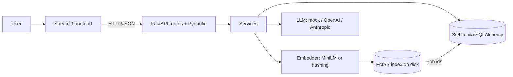

# CareerPilot AI 🧭

Conversational, RAG-based job recommendation chatbot (FastAPI + SQLite + FAISS + Sentence Transformers + Streamlit).
**All 33 jobs are fictional demo data, not live vacancies.**

## Architecture

RAG flow: question → embed → FAISS top-k → fetch rows from SQLite → build context → LLM → answer + sources.
No relevant job (similarity below `RAG_MIN_SCORE`) → the LLM is **not** called.

## Quick start
```bash
python -m venv .venv && source .venv/bin/activate      # Windows: .venv\Scripts\activate
pip install -r requirements-dev.txt
cp .env.example .env                                   # Windows: copy .env.example .env
uvicorn app.main:app --app-dir backend --reload        # terminal 1 -> http://localhost:8000/docs
streamlit run frontend/app.py                          # terminal 2 -> http://localhost:8501
pytest                                                 # tests
```
First run with `EMBEDDING_BACKEND=sentence-transformers` downloads ~90 MB. No internet? set `EMBEDDING_BACKEND=hashing`
(offline, keyword-like, **not** truly semantic) and `RAG_MIN_SCORE=0.15`.
Demo jobs are auto-imported on first start; or run `python scripts/import_jobs.py`.

## LLM configuration (.env)
`LLM_PROVIDER=mock` (default, labelled "MOCK MODE") · `openai` (+ `LLM_BASE_URL` for Groq/Ollama) · `anthropic`.
Set `LLM_API_KEY`. If the provider fails, the app falls back to a labelled mock answer (`mode: mock_fallback`).

## Main endpoints
`GET /` `GET /health` · `POST/GET /api/jobs` `GET /api/jobs/{id}` `POST /api/jobs/semantic-search` `POST /api/jobs/reindex` ·
`POST/GET/PATCH /api/candidates` `…/saved-jobs` `POST /api/resume/upload` · `POST /api/chat` ·
`POST /api/recommendations` `POST /api/skill-gap`

## Recommendation score
`match% = 100 × (0.35·semantic + 0.40·skills + 0.10·location + 0.15·experience)` (weights configurable, auto-normalised).

## Docker
```bash
cp .env.example .env && docker compose up --build   # frontend :8501, backend :8000
```
Deployment: run the two containers on any host (Render, Railway, a VM); mount `data/` as a persistent volume; set `BACKEND_URL`.

## Layout
`backend/app/{api,services,models.py,schemas.py,database.py,config.py}` · `frontend/` · `data/jobs_demo.csv` · `scripts/` · `tests/` · `docs/`

## Known limitations
Rule-based resume/preference parsing; keyword-overlap history recall; no authentication; SQLite is single-node;
scanned (image) PDFs unsupported.
